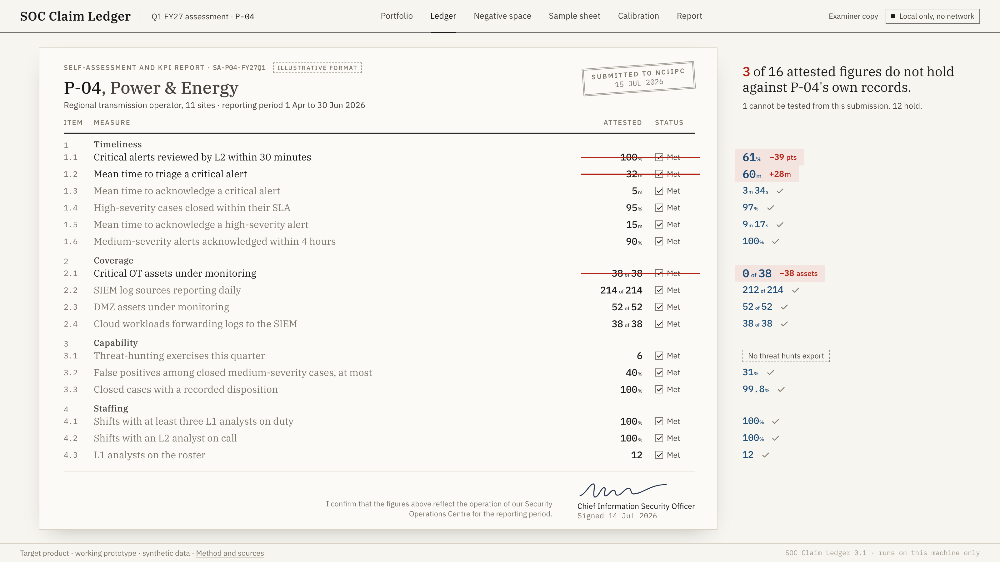

<h1 align="center">SOC Claim Ledger</h1>

<p align="center">What a critical-sector entity signs about its SOC, checked line by line against its own records.</p>

<p align="center"></p>

Every quarter, a critical-sector entity sends NCIIPC a signed self-assessment of its SOC, and the SOC's own alert and case records.
The ledger recomputes every attested figure from those records, opens each broken claim onto the alerts behind it, and finds what should be in the records and is not.
It runs on one machine, with no network, no cloud and no hosted model.

| P-04, one quarter | Attested | Its own records |
|---|---|---|
| Critical alerts reviewed by L2 within 30 minutes | 100% | 61% |
| Mean time to triage a critical alert | 32 m | 60 m |
| Critical OT assets under monitoring | 38 of 38 | 0 of 38 |

A third of P-04's critical alerts close in the last 5 minutes before their 60-minute deadline, and 12 of its closure notes are one pasted paragraph.
Synthetic data from a simulated SOC.
A working prototype, not deployed at NCIIPC.

## Requirements

| Tool | Version | Used for |
|---|---|---|
| Node.js | 20.9 or later, CI uses 22 | the web app, the analysis and the TypeScript tests |
| pnpm | 10.26.2, pinned in `package.json` | the workspace, run `corepack enable` to get it |
| uv | 0.5 or later | the API's Python 3.12 virtualenv, installed from `apps/api/uv.lock` |
| Docker | optional | the offline image and `docker compose up` |

uv downloads Python 3.12 itself when the machine does not have it.

## Install

```bash
git clone https://github.com/heyitsgautham/soc-claim-ledger.git
cd soc-claim-ledger
pnpm bootstrap                               # pnpm install, then the API's .venv from uv.lock
pnpm exec playwright install chromium        # only for the PDF export and the end-to-end test
git config core.hooksPath .githooks          # once per clone, see "Display names" below
```

## Run

```bash
pnpm demo        # simulate, analyse, build, and serve on http://localhost:3157
pnpm dev         # the same data, with the Next.js dev server
```

`pnpm simulate` writes twelve seeded SOC submissions to `data/demo`, and `pnpm analyse` writes what the screens show to `data/demo/derived`.
The web app only renders that output, so both must run before the first build, and the two scripts above run them first.
The web server logs each recorded or refused verdict, each report export, and every request that fails on the server with its route and error digest, to stdout through pino, one JSON object per line.
`GET /api/health` answers 200 with the version, the cycle and the entity count, or 503 naming what is missing when the analysis has not run.
The Docker health check and CI wait on it before they drive the app.

The FastAPI service is separate, and the screens do not need it.

```bash
pnpm --filter @ledger/api ingest   # verify each export's SHA-256 and write the Parquet warehouse
pnpm --filter @ledger/api serve    # http://127.0.0.1:8157/health, /metrics, /entities, /entities/P-04/ledger/sql
```

The API writes one JSON object per request to stderr, with method, path, status, milliseconds and a request ID.
It keeps the caller's `X-Request-ID` when it is plain and at most 64 characters, makes one up otherwise, and echoes it in the response.
Every line logged while a request is served carries that ID.
A failed request also logs its traceback and answers `{"error": ..., "detail": ..., "request_id": ...}`.
`GET /metrics` serves request counts and latencies by route template, rows ingested by export and refused ingest runs, in the Prometheus text format.

### Docker

```bash
docker compose up        # builds the root Dockerfile, serves the web app on 3157 and the API on 8157
make offline-test        # builds the image and runs the end-to-end test inside it with networking removed
```

## Test

One command runs the whole suite from a fresh clone, after `pnpm bootstrap`.

```bash
pnpm test
```

It simulates and analyses the demo data, runs the TypeScript unit tests with Vitest under v8 coverage, then the API tests with pytest under pytest-cov.
Either side fails the run when its coverage drops below its floor.
The pytest run includes the parity test that holds the SQL ledger and the TypeScript ledger to the same numbers for every entity.

| Command | What it runs |
|---|---|
| `pnpm test` | simulate, analyse, `test:coverage`, `test:api` |
| `pnpm test:unit` | every Vitest project in `vitest.config.ts`, `packages/*/test`, `apps/web/test` and the repository checks in `scripts`, without coverage |
| `pnpm test:web` | only the `web` project: helpers, API route handlers, server-rendered components, and interactive ones in happy-dom with Testing Library |
| `pnpm test:coverage` | the unit tests under v8 coverage, failing below the thresholds in `vitest.config.ts` |
| `pnpm test:api` | `apps/api/tests` with pytest and pytest-cov, failing below `fail_under` in `apps/api/pyproject.toml` |
| `pnpm test:e2e` | every screen in Chromium against a running `pnpm start`, failing on any request that leaves the machine, through `vitest.e2e.config.ts` |
| `pnpm lint` | Biome lint and format check over the TypeScript, Ruff check and format check over the Python |
| `pnpm format` | rewrites both sides with Biome and Ruff |
| `pnpm typecheck` | `tsc` in every TypeScript package, after `pnpm --filter @ledger/web build`, and mypy in strict mode over the API |
| `pnpm audit:deps` | `pnpm audit` and `pip-audit` over the lockfiles, high severity and up |

CI runs all of these on every push and pull request, see `.github/workflows/ci.yml`.

## Configuration

Every setting is optional, and the defaults run the demo as committed.
`.env.example` lists each variable the code reads, with its default and the file that reads it.
An empty value means the default.
To change one, copy it to `apps/web/.env.local` and fill in the line.
`scripts/env-example.test.ts` fails when the code reads a variable `.env.example` does not list.

| Variable | Read by | Default |
|---|---|---|
| `LEDGER_DATA_DIR` | web app, API | `data/demo` |
| `LEDGER_LOCAL_DIR` | web app | `data/local` |
| `LEDGER_EXAMINER` | web app | `EX-02` |
| `LOG_LEVEL` | web app | `info` |
| `LEDGER_WAREHOUSE_DIR` | API | `$LEDGER_DATA_DIR/parquet` |
| `LEDGER_URL` | end-to-end test | `http://localhost:3157` |
| `NEXT_PUBLIC_*`, `PRIVATE_TERMS`, `PRODUCT_SAY` | web app, recording, `pnpm check:names` | unset |

### Display names

Names for the demo video are local settings in `apps/web/.env.local`, which git ignores.
The pre-commit hook in `.githooks` runs `pnpm check:names`, which refuses a commit that would publish any of them.

## Architecture

```text
 data/demo submission      packages/submission      packages/claims + packages/detect        apps/web
 manifest, claims,    ---> SHA-256 and row     ---> claim-to-query ledger,          ---> Next.js screens,
 alert and case exports    counts, zod schemas      detectors, findings, risk            verdict and PDF routes
        |                                                     ^                                |
        +----> apps/api: Parquet warehouse ---> DuckDB SQL ---+ parity test                    v
                                                                                         data/local
```

```
apps/web/            Next.js app, every screen, self-hosted fonts, no request leaves the machine
apps/api/            FastAPI over DuckDB and Parquet, the same ledger recomputed in SQL
packages/claims/     each attested figure mapped to a query over the records, findings, risk, sampling
packages/detect/     SLA bunching, pasted notes, negative space, weekend coverage, repeat alerts
packages/simulate/   a seeded SOC: analysts, shifts, queues, SLAs and the habits behind each finding
packages/submission/ the submission contract, schemas and SHA-256 checked loader
deploy/              the offline test, the USB bundle and its install script
recording/           the scripted demo take and its voiceover
```

The full design is in [docs/architecture.md](docs/architecture.md), with a two-page [PDF](docs/architecture.pdf).

[Methodology](docs/methodology.md) · [Validation](docs/validation.md) · [Requirements](docs/requirements.md) · [Research](docs/research.md) · [Contributing](CONTRIBUTING.md) · [Changelog](CHANGELOG.md)

<sub>MIT licensed. Team 1, Saveetha Engineering College.</sub>
